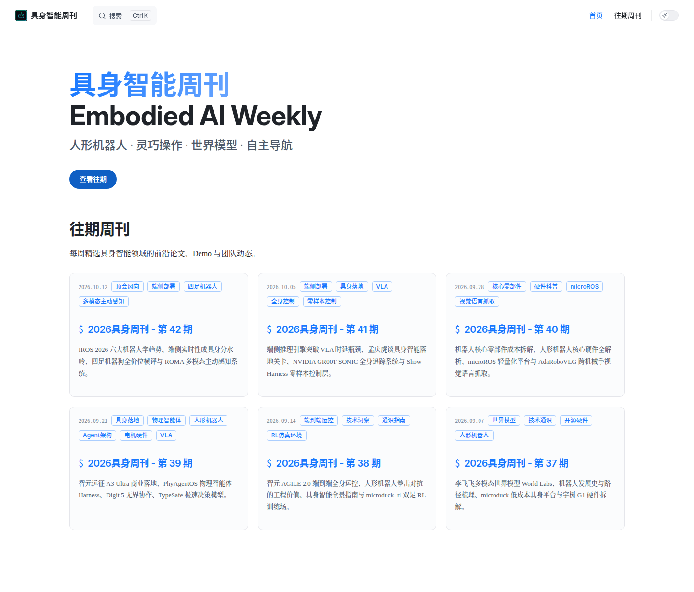
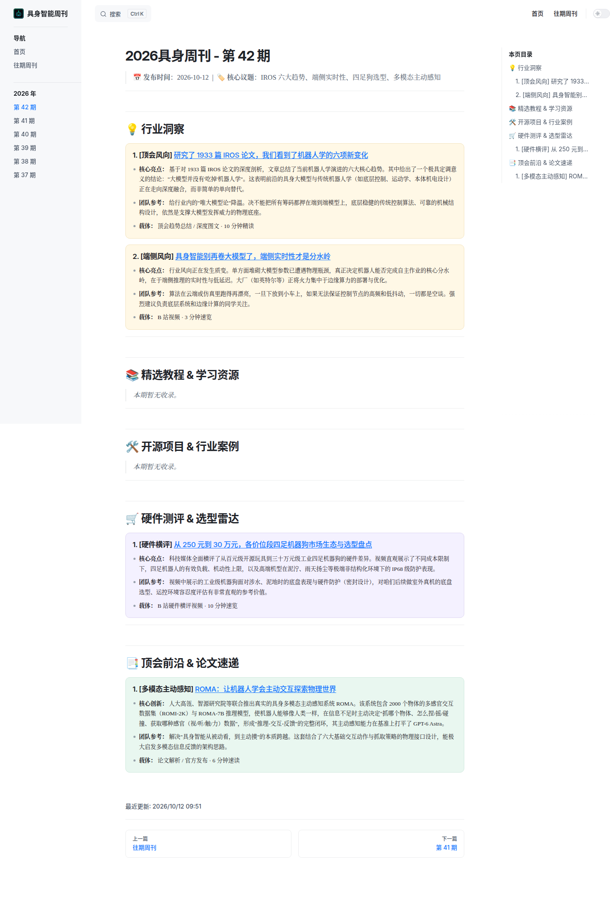

<div align="center">

# 🤖 具身智能周刊

**Embodied AI Weekly** — 人形机器人 · 灵巧操作 · 世界模型 · 自主导航

每周精选具身智能领域的前沿论文、开源项目、工程实践与行业动态，
以「核心亮点 + 团队参考」的工程视角解读，帮团队快速锁定值得跟进的信息。

[](https://github.com/kingdream-cn/embodied-ai-weekly/actions/workflows/deploy.yml)
[](https://kingdream-cn.github.io/embodied-ai-weekly/)
[](https://vitepress.dev/)
[](https://nodejs.org/)
[](https://github.com/kingdream-cn/embodied-ai-weekly/commits/main)
[](https://github.com/kingdream-cn/embodied-ai-weekly/stargazers)

🌐 **在线阅读：[kingdream-cn.github.io/embodied-ai-weekly](https://kingdream-cn.github.io/embodied-ai-weekly/)**

</div>

---

## 📖 项目概述

**具身智能周刊** 是一个面向具身智能从业者与爱好者的每周内容精选站点，聚焦 **人形机器人、灵巧操作、世界模型、自主导航** 等方向。

每期从顶会论文、行业报告、技术社区与视频平台中筛选真正值得花时间的内容，按固定板块归档，并给出工程视角的解读：

- 🎯 **核心亮点**：一句话讲清这条内容到底讲透了什么；
- 🔧 **团队参考**：站在工程团队角度，说明这条内容对我们意味着什么、该怎么做。

站点基于 **VitePress** 构建，全站静态生成（SSG），内容以 Markdown 文件维护，推送 `main` 分支后由 **GitHub Actions** 自动构建并发布到 **GitHub Pages**。所有周刊归档均可在在线阅读站点中查阅与全文搜索。

> 💡 适合人群：具身智能 / 机器人方向的算法工程师、系统工程师、产品与研究者，以及希望快速跟进该领域的团队。

---

## 📸 项目截图

| 首页（Hero + 往期周刊网格） | 周刊详情页（板块卡片 + 侧栏大纲） |
| :---: | :---: |
|  |  |

---

## ✨ 功能特性

- 🗂️ **六大内容板块**：行业洞察、精选教程 & 学习资源、开源项目 & 行业案例、工程实战 & 踩坑记录、硬件测评 & 选型雷达、顶会前沿 & 论文速递；
- 🎯 **「核心亮点 + 团队参考」双视角解读**：不止有摘要，更有落地参考价值；
- 🎨 **板块配色系统**：每个板块拥有独立强调色，卡片边框、列表圆点与链接颜色随之联动，一眼区分内容类型；
- 🌓 **明暗主题切换**：钉钉风浅色主题（品牌色 `#1677FF`）与深色主题自由切换；
- 🔍 **站内全文搜索**：基于 VitePress 本地索引，无需外部服务；
- 🧭 **右侧大纲精准跳转**：卡片内的条目标题（三级标题）会被大纲解析，长文阅读不迷路；
- 📚 **归档自动聚合**：`issues/*.md` 内容文件自动生成卡片网格（标题、日期、摘要、标签），无需手动维护列表；
- 📅 **更新节奏稳定**：以周为单位持续更新（当前已更新至第 42 期）；
- 📱 **响应式布局**：桌面与移动端均有良好阅读体验；
- 🚀 **CI/CD 自动部署**：推送到 `main` 即自动构建并上线 GitHub Pages。

---

## 🧰 技术栈

| 类别 | 技术 | 说明 |
| --- | --- | --- |
| 静态站点框架 | [VitePress](https://vitepress.dev/) `^1.6` | 基于 Vite 与 Vue 3 的静态站点生成器 |
| 内容增强 | [markdown-it-container](https://github.com/markdown-it/markdown-it-container) `^4.0` | 实现 `::: card`、`::: key-points` 周刊卡片容器 |
| 主题样式 | 原生 CSS（VitePress 设计令牌） | 钉钉风配色、板块强调色、明暗双主题 |
| 数据层 | VitePress Content Loader | 自动扫描 `issues/*.md`，生成归档卡片数据 |
| 构建运行时 | Node.js ≥ 20 | 本地与 CI（Node 20）构建环境 |
| 部署 | GitHub Actions + GitHub Pages | `main` 分支推送触发自动构建发布 |

---

## 🚀 快速开始

### 环境要求

- **Node.js ≥ 20**（推荐 LTS）
- npm（随 Node 附带即可）

### 本地运行

```bash
# 1. 克隆仓库
git clone git@github.com:kingdream-cn/embodied-ai-weekly.git
cd embodied-ai-weekly

# 2. 安装依赖
npm install

# 3. 启动开发服务器（热更新）
npm run docs:dev
# 打开 http://localhost:5173/embodied-ai-weekly/
```

### 常用命令

| 命令 | 说明 |
| --- | --- |
| `npm run docs:dev` | 启动本地开发服务器（支持热更新） |
| `npm run docs:build` | 构建生产产物到 `dist/` |
| `npm run docs:preview` | 本地预览构建产物 |

---

## 📦 部署方式

### 方式一：GitHub Actions 自动部署（推荐，本项目采用）

仓库已内置工作流 [`.github/workflows/deploy.yml`](.github/workflows/deploy.yml)，推送 `main` 分支后自动完成 **构建 → 发布 GitHub Pages** 全流程；也可在 Actions 页面手动触发（`workflow_dispatch`）。

**首次启用步骤：**

1. 进入仓库 `Settings → Pages`，将 **Source** 设置为 **GitHub Actions**；
2. 推送任意提交到 `main` 分支（或手动触发工作流）；
3. 构建完成后访问 `https://<owner>.github.io/<repo>/`。

**关于 `base` 路径：**

- 本项目部署为**项目站点**，`.vitepress/config.mjs` 中已设置 `base: '/embodied-ai-weekly/'`；
- 若你的仓库名不同，请同步修改该值；若部署为**用户/组织站点**（`<owner>.github.io` 根路径），将 `base` 改为 `'/'`。

### 方式二：手动构建，部署到任意静态托管

```bash
npm run docs:build      # 产物输出到 dist/
```

将 `dist/` 目录整体上传到 Nginx、Vercel、Netlify、OSS/COS 等任意静态托管服务即可（注意同步调整 `base` 路径）。

---

## 📖 使用说明

### 浏览站点

- 顶部导航切换 **首页 / 往期周刊**；
- 首页卡片网格展示全部期次（标题、日期、摘要、标签），点击进入对应期次；
- 周刊详情页左侧为**分期导航**，右侧为**本页目录**（可跳转到具体条目），支持明暗主题切换；
- 使用顶部搜索框（或 `Ctrl / ⌘ + K`）进行站内全文搜索。

### 撰写新一期周刊

**第 1 步：新建内容文件**，在 `issues/` 目录下创建 `issue-XX.md`，并填写 frontmatter：

```markdown
---
title: "2026具身周刊 - 第 43 期"
date: 2026-10-19
description: "本期一句话导读，将展示在首页卡片上。"
tags:
  - 顶会风向
  - 端侧部署
---

# 2026具身周刊 - 第 43 期

> 📅 **发布时间**：2026-10-19 &nbsp;|&nbsp; 🏷️ **核心议题**：xxx、yyy、zzz

---

## 💡 行业洞察

::: card insight
### 1. [端侧风向] [条目标题（指向原文的真实链接）](https://example.com)

- **核心亮点：** 提炼内容价值与关键结论。
- **团队参考：** 站在工程团队角度的行动建议。
- **载体：** B 站视频 · 10 分钟速览
:::
```

**第 2 步：使用卡片容器**。每个条目用 `::: card <板块标识>` 包裹，板块标识与配色对应关系如下：

| 板块 | 容器标识 | 卡片配色 |
| --- | --- | :---: |
| 💡 行业洞察 | `insight` | 暖黄 |
| 📚 精选教程 & 学习资源 | `tutorial` | 中性灰 |
| 🛠️ 开源项目 & 行业案例 | `opensource` | 浅粉 |
| ⚙️ 工程实战 & 踩坑记录 | `practice` | 浅蓝 |
| 🛒 硬件测评 & 选型雷达 | `review` | 浅紫 |
| 📑 顶会前沿 & 论文速递 | `paper` | 浅绿 |

> 开关容器需成对书写（`::: card insight` … `:::`）；条目标题使用三级标题 `###`，确保能被右侧大纲解析并精准跳转。

**第 3 步：更新侧边栏**，在 `.vitepress/config.mjs` 的 `themeConfig.sidebar` 中补充新一期链接。

**第 4 步：本地预览确认无误后**，提交并推送到 `main` 分支，等待 GitHub Actions 自动发布。

---

## 📂 项目结构

```text
embodied-ai-weekly/
├── .github/workflows/deploy.yml   # GitHub Actions 自动部署工作流
├── .vitepress/
│   ├── config.mjs                 # 站点配置（导航 / 侧边栏 / 搜索 / 卡片容器）
│   └── theme/
│       ├── index.ts               # 主题入口
│       ├── style.css              # 钉钉风设计令牌与卡片样式
│       ├── issues.data.ts         # 周刊数据加载器（扫描 issues/*.md）
│       └── components/
│           └── IssuesGrid.vue     # 「往期周刊」卡片网格组件
├── issues/                        # 周刊正文（Markdown，每期一个文件）
│   ├── index.md                   # 往期周刊归档页
│   ├── issue-37.md
│   └── ...                        # issue-XX.md
├── public/                        # 静态资源（logo 等，构建时原样拷贝）
├── screenshots/                   # README 项目截图
├── index.md                       # 首页（Hero + 往期周刊网格）
└── package.json
```

---

## 🤝 贡献指南

欢迎任何形式的贡献，感谢你帮助这份周刊变得更好！

### 推荐选题 / 内容勘误

- 发现值得收录的文章、视频、开源项目，或发现正文链接失效、描述有误，请直接提交 [Issue](https://github.com/kingdream-cn/embodied-ai-weekly/issues)；
- 推荐内容时，请附上**原文链接**与**一句话推荐理由**，便于快速评估。

### 代码与样式改进

1. **Fork** 本仓库并新建分支，如 `feat/card-hover`、`fix/sidebar-link`；
2. 提交时使用语义化前缀（与仓库历史风格保持一致）：`feat:` / `fix:` / `style:` / `docs:` / `chore:`；
3. 建议一次 PR 只做一件事，并在 PR 描述中说明**变更内容**与**验证方式**；
4. 发起 **Pull Request**，等待 Review 合入。

> 注意：周刊选题与文案保持统一的编辑口径，**新增/修改周刊内容**建议先通过 Issue 沟通，避免直接改动正文。

---

## 📬 联系方式

- **GitHub**：[@kingdream-cn](https://github.com/kingdream-cn)
- **问题反馈**：[提交 Issue](https://github.com/kingdream-cn/embodied-ai-weekly/issues)
- **在线阅读**：[https://kingdream-cn.github.io/embodied-ai-weekly/](https://kingdream-cn.github.io/embodied-ai-weekly/)

---

<div align="center">

**如果这份周刊对你有帮助，欢迎 ⭐ Star 支持一下！**

<sub>Made with ❤️ by kingdream-cn · Powered by VitePress</sub>

</div>